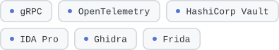

<picture>
  <source media="(prefers-color-scheme: dark)" srcset="./assets/header-dark.svg">
  <source media="(prefers-color-scheme: light)" srcset="./assets/header-light.svg">
  
</picture>

 
 

Hey, I'm Arman 👋

I work on the backend and network side of things, the stuff that has to keep running at 3am when nobody's watching. I also can't leave closed software alone. If I don't know how something works, it's ending up in a disassembler.

Powered by an honestly concerning amount of coffee ☕. Off the clock I'm usually in ranked 🎮, losing and blaming the netcode. Occupational hazard.

 

### What I do

<table>
  <tr>
    <td width="50%" valign="top">
      <h4><picture></picture> Distributed Systems &amp; Networking</h4>
      High-concurrency network services built to scale horizontally. Custom protocol design, connection multiplexing, backpressure, and graceful degradation when a whole region goes dark.
        
    </td>
    <td width="50%" valign="top">
      <h4><picture></picture> Platform Engineering</h4>
      Multi-cloud Kubernetes platforms managed end to end with Terraform and GitOps. SLO-based alerting, distributed tracing, and zero-downtime rollouts as the baseline.
        
    </td>
  </tr>
  <tr>
    <td width="50%" valign="top">
      <h4><picture></picture> Reverse Engineering &amp; Security Research</h4>
      Static and dynamic analysis of closed-source binaries and proprietary protocols. Disassembly, runtime instrumentation and hooking to find out what software actually does, not what the docs claim.
        
    </td>
    <td width="50%" valign="top">
      <h4><picture></picture> Systems Programming</h4>
      Performance-critical native code in C++ and Rust. Lock-free concurrency, cache-aware data structures, and deep OS integration on Windows and Linux.
        
    </td>
  </tr>
</table>

 

### Toolbox

<picture>
  <source media="(prefers-color-scheme: dark)" srcset="https://skillicons.dev/icons?i=go%2Crust%2Ccpp%2Cts%2Cpy%2Ckubernetes%2Cterraform%2Caws%2Ccloudflare%2Ckafka%2Cpostgres%2Credis%2Cprometheus%2Cgrafana&amp;perline=7&amp;theme=dark">
  
</picture>
 
 
<picture>
  <source media="(prefers-color-scheme: dark)" srcset="./assets/tags-toolbox-dark.svg">
  
</picture>

 
 

### Say hi

Got an interesting problem? My inbox is open.

<a href="mailto:arman.seyri@gmail.com">
  <picture>
    <source media="(prefers-color-scheme: dark)" srcset="./assets/contact-dark.svg">
    
  </picture>
</a>
